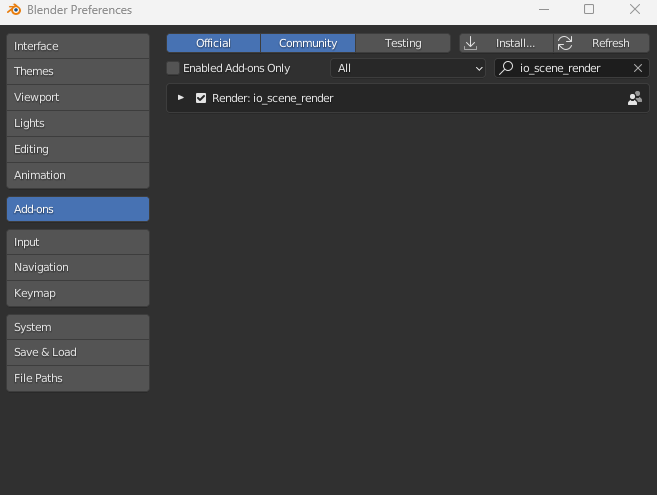
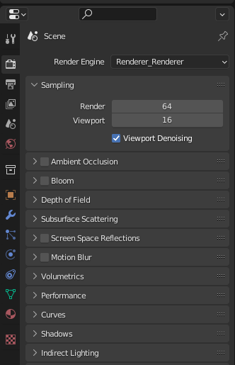
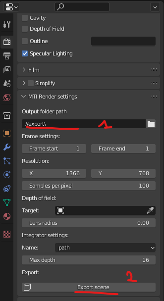

# MTI 870 - Blender exporter

This is the experimental blender exporter for MTI 870. 
This plugin has been tested with Blender 5.2. It requires at least Blender 4.1.

Meshes are exported as binary PLY files (`meshes/<frame>/<name>_mat<i>.ply`), one per material of the object. Vertices are unique per (position, normal, UV), so the face indices can also be used as tangent indices. Objects sharing the same mesh and without modifiers reference the same file: the renderers still load one copy per object (instancing is not supported).

## Installation

The main steps for installing this plugin:
1) Zip the directory `io_scene_render` inside this directory
2) Open Blender and go to: `Edit > Preferences > Add-ons` and click on the install button. 
3) Select the zip file created in the first step. 
4) Activate the plugin

5) Select `Renderer_Render` in the render engine

6) Go to the bottom of the panel (scrolling down). Specify inside `MTI Render settings` the output directory. Press export the scene.

## TODOs
- Support more conversion from Cycles materials to renderer
- Add custom nodes for special BSDF
- Export envmap or background color
- Add more options to the exporter
- Export volume
